# nubeduca-plantilla-servicio

Plantilla que copia cada microservicio de Nubeduca (tarea **LIB-01**). Trae resuelto lo que todos necesitan: API Gateway + Lambda con el LabRole, tabla DynamoDB con `tenant_id` en la clave, **outbox** para publicar eventos, **inbox idempotente** para consumirlos y logs estándar.

- Responsables: Dev 3 (@btoroled) y Dev 5 (@AIexander-lx). La aprueba Dev 3.
- Sigue los contratos de [`nubeduca-contratos`](https://github.com/nubeduca/nubeduca-contratos) ("Cómo se publica un evento" y "Cómo se consume un evento").
- El inbox, la autenticación, los logs y los ids se basan en `nubeduca-ms-notificaciones` (Dev 6).

**Criterio de LIB-01:** un servicio de ejemplo publica y consume en local sin duplicados → `python scripts/probar_local.py` (ver [Probar en local](#probar-en-local)).

## Cómo funciona

```mermaid
flowchart LR
    FE["Frontend"] --> API["API Gateway"] --> L1["λ comando<br/>(api/)"]
    L1 -- "TransactWriteItems<br/>cambio + EVENTO#" --> DB[("DynamoDB<br/>&lt;stage&gt;-t_&lt;servicio&gt;")]
    DB -- "Stream (INSERT EVENTO#)" --> R["Pipe (outbox=pipe)<br/>o λ relay (outbox=lambda)"]
    R --> BUS{{"EventBridge · bus lms"}}
    BUS -- "regla del consumidor" --> Q["SQS + DLQ ×5"] --> L2["λ consumidor<br/>(consumidores/)"]
    L2 -- "INBOX# + AGG# + cambio" --> DB2[("tabla del consumidor")]
```



1. **Publicar (outbox).** El comando nunca llama a EventBridge. `outbox.guardar()` escribe el cambio y el ítem `EVENTO#<eventId>` en la misma `TransactWriteItems`: o se guardan los dos, o ninguno.
2. **Llevar al bus.** El Stream de la tabla manda cada `INSERT` de un `EVENTO#` al bus `lms`, con EventBridge Pipes o con la Lambda `relay/stream_a_bus.py`.
3. **Consumir (inbox).** Una regla por consumidor copia el evento a su cola SQS. `inbox.manejar_lote()` guarda `INBOX#<eventId>` con escritura condicional en la misma transacción que el cambio, así un evento repetido se descarta. Un evento con `aggregateVersion` vieja también se descarta.

## Estructura

```text
nubeduca-plantilla-servicio/
├── serverless.yml            # API, tabla con Stream, relay/Pipe, regla + cola + DLQ del consumidor
├── lib/                      # se copia tal cual a cada servicio
│   ├── config.py             # variables de entorno, tenants y roles
│   ├── auth.py               # usuario del token (Cognito o mock); el tenant nunca sale del body
│   ├── http.py               # respuestas y errores {code, message, requestId}
│   ├── ids.py                # ids prefijo + ULID (fil_, mod_, ...)
│   ├── logs.py               # {"tipo": "INFO" | "ERROR", "log_datos": {...}}
│   ├── tabla.py              # tabla única tenant_id + sk y prefijos reservados
│   ├── outbox.py             # nuevo_evento() y guardar(cambios, eventos)
│   └── inbox.py              # leer_mensaje(), procesar() y manejar_lote()
├── api/                      # handlers HTTP (ejemplo: /health y /examples)
├── consumidores/             # reacciones a eventos (ejemplo: ejemplo.py)
├── relay/stream_a_bus.py     # outbox → bus cuando no se usa Pipe
├── scripts/probar_local.py   # criterio de LIB-01 en LocalStack
└── tests/                    # pytest + moto (sin AWS)
```

## Tabla única

PK `tenant_id` (HASH) + `sk` (RANGE), `PAY_PER_REQUEST`, Stream `NEW_IMAGE` y TTL en `ttl`. El tenant va siempre en la clave de partición, así que una consulta nunca cruza instituciones.

| `sk` | Qué es | Quién lo escribe |
|---|---|---|
| `EVENTO#<eventId>` | Ítem de outbox: `source`, `detailType`, `detail` (JSON en texto), `ttl` 7 días | `outbox.guardar()` |
| `INBOX#<eventId>` | Evento ya procesado, `ttl` 7 días | `inbox.procesar()` |
| `AGG#<tipo>#<id>` | Última `aggregateVersion` vista de una entidad de otro servicio | `inbox.procesar()` |
| `EXAMPLE#<id>` | Entidad del ejemplo (en tu servicio: `FILE#`, `MODULE#`, ...) | tu código |
| `PROY#...` | Proyección de datos de otro servicio (en el ejemplo) | tu consumidor |

`poblar_datos.py` **no** escribe ítems `EVENTO#`, para que cargar los 30.000 registros no inunde el bus.

## Publicar un evento

```python
from lib import outbox

evento = outbox.nuevo_evento(
    "lms.content.module.published.v1",
    tenant_id=usuario.tenant_id,          # del token, nunca del body
    aggregate_type="module",
    aggregate_id=module_id,
    aggregate_version=2,
    actor_id=usuario.user_id,
    course_id=course_id,                  # obligatorio en eventos de un curso
    data={"moduleId": module_id, "title": titulo, "position": 3, "itemCount": 4},
)
outbox.guardar(
    cambios=[{"Update": {"Key": {...}, "UpdateExpression": "SET #s = :p", ...}}],
    eventos=[evento],
)
```

El `detail` sale con la forma del contrato: `{"metadata": {eventId, tenantId, occurredAt, aggregateType, aggregateId, aggregateVersion, actorId, courseId?}, "data": {...}}`.

## Consumir un evento

```python
from lib import inbox

def guardar_curso(evento: inbox.Evento) -> list:
    return [{"Put": {"Item": {"tenant_id": evento.tenant_id,
                              "sk": f"COURSE#{evento.course_id}",
                              "ownerId": evento.data["ownerId"]}}}]

REACCIONES = {"lms.courses.course.created.v1": guardar_curso}

def lambda_handler(event, context):
    return inbox.manejar_lote(event, REACCIONES)
```

En `serverless.yml`, la regla del consumidor filtra por `source` y `detail-type` de los eventos que te tocan según el catálogo.

## Cómo crear tu microservicio

1. Copia la plantilla a tu repo `nubeduca-ms-<nombre>`.
2. En `serverless.yml`, cambia `org`, `service`, `SERVICIO`, `EVENT_SOURCE` (tu `source` del catálogo, por ejemplo `lms.content`), el nombre de la tabla y de las colas, y el `EventPattern` de la regla.
3. Reemplaza `api/ejemplos.py` por las rutas de tu OpenAPI, y `consumidores/ejemplo.py` por tus reacciones.
4. Agrega `poblar_datos.py` (30.000 registros, 10.000 por tenant) y la estructura JSON de tu tabla en tu README.

## Parámetros de despliegue

```bash
serverless deploy --stage dev                                  # outbox con la Lambda relay
serverless deploy --stage dev --param="outbox=pipe"            # outbox con EventBridge Pipes
serverless deploy --stage dev --param="authMode=cognito"       # cuando AUTH-01 entregue Cognito
```

| Parámetro | Por defecto | Para qué |
|---|---|---|
| `busName` | `lms` | Bus de EventBridge. Con Compose llega de `infra/bus` |
| `outbox` | `lambda` | `lambda`: relay con el Stream. `pipe`: EventBridge Pipes (hay que confirmar que el LabRole lo permite) |
| `authMode` | `mock` | `mock`: token `Bearer mock.<tenant>.<ROL>.<userId>` del frontend. `cognito`: claims del authorizer |

El bus `lms` lo crea `infra/bus` (PLT-04). Mientras no exista en AWS, créalo a mano: `aws events create-event-bus --name lms`.

## Probar

**Pruebas unitarias** (sin AWS, con moto):

```bash
pip install -r requirements-dev.txt
python -m pytest -q
```

Cubren: publicar y consumir sin duplicados, descarte de eventos viejos, transacción atómica (si falla el cambio no se guarda el evento), tenant tomado del token y permisos.

### Probar en local

Con el LocalStack de LOC-01 levantado:

```bash
cd nubeduca-infra/localstack && docker compose up -d --wait
cd ../../nubeduca-plantilla-servicio
pip install -r requirements.txt
python scripts/probar_local.py
```

Salida esperada:

```text
▶ POST /examples como docente de UTEC (guarda el ejemplo + EVENTO# en una transacción)
201 {...}
▶ Relay: Stream → bus lms
eventos publicados: 1
▶ Consumidor: leyendo la cola
1ª entrega: PROCESADO
2ª entrega (SQS reintenta): DUPLICADO
✓ LIB-01: publica y consume sin duplicados
```

## Pendiente

- [ ] Confirmar en AWS si el LabRole permite EventBridge Pipes (`outbox=pipe`). Si no, se queda la Lambda relay.
- [ ] Validar `detail` contra el JSON Schema de `nubeduca-contratos` antes de guardar el evento.
- [ ] Authorizer de Cognito en las rutas cuando AUTH-01 entregue el User Pool.
- [ ] `traceparent` y X-Ray (PLT-06).
